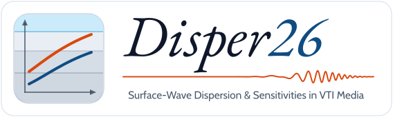

# 

Disper26 computes Rayleigh and Love surface-wave dispersion in isotropic and
vertically transversely isotropic (VTI) layered media. Its C++, C, Fortran
and Python interfaces provide eigenfunctions, sensitivity kernels and
phase-velocity Hessians.

**Version 0.1.104** is a local publication candidate.

## Quick start

After [installing Disper26](docs/install.md), compute the fundamental Rayleigh
phase velocity for a 10 km layer over a half-space.

```python
import disper26 as d26

# Layer tops in km, vs and vp in km/s, density in g/cm³, period in seconds.
model = d26.create_model([0., 10.], kind="layer_cake",
                         vs=[3., 4.5], vp=[5.2, 8.], rho=[2.5, 3.3])
solution = d26.compute_dispersion(model, period=5.)
print(f"{solution.phase_velocity:.3f} km/s")  # 2.856 km/s
```

Explore [VTI and isotropic dispersion curves and Rayleigh eigenfunctions to 30 km](examples/README.md#1-model-construction-and-dispersion-curves)
in the practice examples ([Japanese edition](example_jp/README.md)).
For model parameters, units and solver options, see the [API guide](docs/public_api.md)
([Japanese edition](docs_jp/public_api.md)) or the [low-level API reference](docs/lowlevel_api.md).

## Verification

From the repository root in your dedicated environment, run the practice examples as tests.

```sh
python -m pip install '.[test]'
python -m pytest -q tests/python/test_examples.py
```

The [installation guide](docs/install.md) covers the full Python and native test
suites. The [paper guide](paper/README.md) describes historical figure reproduction.
The public tests use bundled inputs. External-program comparisons are maintained separately.

The author used generative AI tools to help derive equations, design
verification procedures, debug the research code, and review the software
documentation. The author checked the derivations and numerical results and
takes responsibility for the software.

## Citation

At manuscript submission, this repository will become public with its history
preserved, and a versioned GitHub release will be archived with Zenodo.

If you use Disper26, please cite the software version you used. Machine-readable
citation metadata are provided in [CITATION.cff](CITATION.cff). Until the first
public release, identify the source commit used in your work. The publication
date, repository URL, and Zenodo DOI will be added when
confirmed; no software DOI has been assigned yet.

Please also cite the accompanying paper when it is available. Software and
paper citations identify different research contributions. Citation is
requested as scholarly practice and is not an additional license condition.

## License and attribution

Copyright (C) 2026 Kiwamu Nishida.

Except for third-party components with their own notices, the original
Disper26 software is distributed under the **GNU General Public License,
version 2 or, at your option, any later version** (`GPL-2.0-or-later`).
See [LICENSE](LICENSE) for the full terms. The software is provided without
warranty, including any implied warranty of merchantability or fitness for a
particular purpose.

Third-party components retain their original licenses. Bundled PREM tables and
adapted model inputs are redistributed under **CC BY 4.0**, based on
[EarthScope's data policy](https://resess.unavco.org/data/policies_forms/data-policy/data-license.html).
They come from the IRIS EMC anisotropic PREM table now distributed by
EarthScope. See [NOTICE](NOTICE) for source links, verified fingerprints,
model and data-provider credits, and descriptions of changes. The accompanying
manuscript is distributed separately and is not licensed by this software notice.
