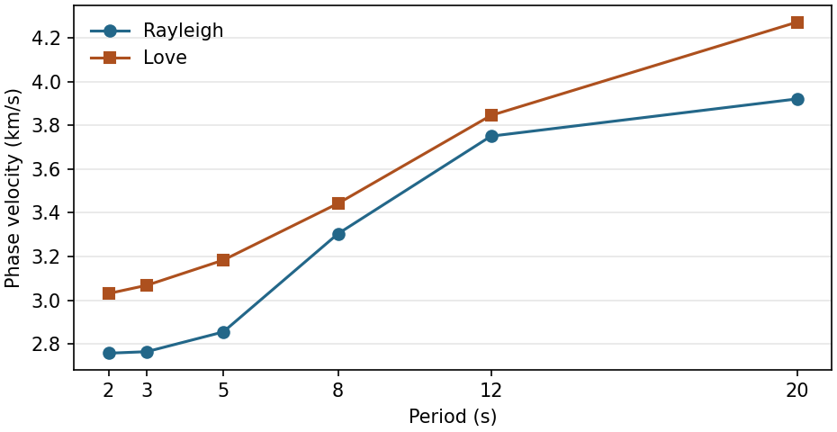

# Disper26

Disper26 computes Rayleigh and Love surface-wave dispersion in isotropic and
vertically transversely isotropic layered media. It provides C++, C, Fortran
and Python interfaces, automatic-differentiation kernels and phase-velocity
Hessians, and Romberg refinement for gradient models.

## Release status

The current software version is **0.1.104**, a local publication candidate.
The original Disper26 software is licensed under GPL-2.0-or-later. Verified
PREM provenance, its CC BY 4.0 terms, and dependency notices are recorded in
[NOTICE](NOTICE); see [License and attribution](#license-and-attribution).
No public release has been issued.

At manuscript submission, this software repository will become public with its
development history preserved. A versioned GitHub release will be archived
with Zenodo. The research comparison repository is maintained separately.

## Build and use

For a Git clone, initialize the pinned autodiff dependency with
`git submodule update --init`. Source archives use the dependency selection
described in [installation](docs/install.md). Requirements are C++17,
CMake 3.18+, Eigen 3.4.x and, for Python, NumPy and pybind11 2.10+.
On macOS the build requires GNU GCC/libstdc++ and Homebrew `eigen@3`.
The `disper26py` distribution installs both Python APIs. For model building,
dispersion, sensitivity kernels and Hessians, use the high-level API
(`import disper26 as d26`). This includes interface derivatives with internal
Earth flattening on a spherical stiffness GRID. Import the low-level API
(`import disper26py as d26_lowlevel`) when you need to supply roots for
individual refinement levels or compare numerical methods directly.
Use Python 3.8+ in a dedicated environment; do not install into Conda base.
The commands below use the Python interpreter from that environment. See
[installation](docs/install.md) for environment setup and native dependencies.

```sh
python -m pip install .
# Optional inverse modelling with SciPy:
python -m pip install '.[inversion]'
# Optional numerical and plotting dependencies for paper reproduction:
python -m pip install '.[paper]'
```

```python
import disper26 as d26

# Layer tops in km, vs and vp in km/s, density in g/cm³, period in seconds.
model = d26.create_model([0., 10.], kind="layer_cake",
                         vs=[3., 4.5], vp=[5.2, 8.], rho=[2.5, 3.3])
solution = d26.compute_dispersion(model, period=5.)
print(solution.phase_velocity)  # km/s
```



The markers show the six periods computed by the [dispersion example](examples/basic_dispersion.py)
for the same 10 km layer over a half-space. At 5 s the Rayleigh phase velocity
is 2.856 km/s, matching the calculation above.

The [practice examples](examples/README.md) cover layered dispersion, mode
tracking, Rayleigh eigenfunctions, gradient-model convergence and predictions
using kernels and Hessians. All inputs are included.
See also [installation](docs/install.md), [shared API](docs/public_api.md),
[low-level API](docs/lowlevel_api.md), and [historical paper reproduction](paper/README.md).
Documented low-level deprecated aliases remain callable. Method-specific
limitations and convergence diagnostics are part of the API contract.

Japanese editions of the [API guide](docs_jp/public_api.md) and
[practice examples](example_jp/README.md) are also available.

## Verification

Run these commands from the repository root in your dedicated environment.
To run the four practice examples as tests, install the test extra:

```sh
python -m pip install '.[test]'
python -m pytest -q tests/python/test_examples.py
```

For development and the full Python suite, install the build dependencies
in the active environment before building the extension in place. The
`paper` extra supplies SciPy and Matplotlib.

```sh
python -m pip install 'setuptools>=64' wheel 'cmake>=3.18' 'pybind11>=2.10'
python -m pip install '.[test,paper]'
python setup.py build_ext --inplace
python -m pytest -q tests/python
```

The native suite below includes the Fortran interface and requires a Fortran
compiler such as gfortran.

```sh
cmake -S . -B build-native -DCMAKE_BUILD_TYPE=Release \
  -DDISPER26_BUILD_FORTRAN=ON -DDISPER26_BUILD_PYTHON=OFF
cmake --build build-native --parallel 2
(cd build-native && ctest --output-on-failure)
```

The public tests cover Disper26 and use bundled, self-contained inputs.
External-program comparisons and their reference output are maintained
separately. The tracking fixture contains model nodes only.

The author used generative AI tools to help derive equations, design
verification procedures, debug the research code, and review the software
documentation. The author checked the derivations and numerical results and
takes responsibility for the software.

## Citation

If you use Disper26, please cite the software version you used. Machine-readable
citation metadata are provided in [CITATION.cff](CITATION.cff). Until the first
public release, identify the source commit used in your work. The publication
date, repository URL, and Zenodo DOI will be added when
confirmed; no software DOI has been assigned yet.

Please also cite the accompanying paper when it is available. Software and
paper citations identify different research contributions. Citation is
requested as scholarly practice and is not an additional license condition.

## License and attribution

Copyright (C) 2026 Kiwamu Nishida.

Except for third-party components with their own notices, the original
Disper26 software is distributed under the **GNU General Public License,
version 2 or, at your option, any later version** (`GPL-2.0-or-later`).
See [LICENSE](LICENSE) for the full terms. The software is provided without
warranty, including any implied warranty of merchantability or fitness for a
particular purpose.

Third-party components retain their original licenses. Bundled PREM tables and
adapted model inputs are redistributed under **CC BY 4.0**, based on
[EarthScope's data policy](https://resess.unavco.org/data/policies_forms/data-policy/data-license.html).
They come from the IRIS EMC anisotropic PREM table now distributed by
EarthScope. See [NOTICE](NOTICE) for source links, verified fingerprints,
model and data-provider credits, and descriptions of changes. The accompanying
manuscript is distributed separately and is not licensed by this software notice.
