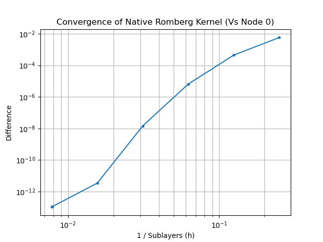
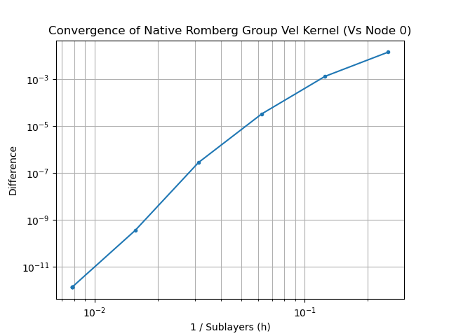

# GRID Mode Romberg Acceleration

Richardson Extrapolation (Romberg Acceleration) for high-precision dispersion curve and sensitivity kernel calculations.

## Overview

For continuous structures (linear interpolation models), this feature achieves O(h²) convergence and high-precision calculations by recursively subdividing layer segments by $2^n$ and applying Richardson extrapolation.

## Python API

### Dispersion Only

```python
import disper26py as dp

c, U, HV, level, rel_err = dp.compute_dispersion_romberg(
    depths=[0, 10, 20, 30],  # km
    params=[p0, p1, p2, p3],  # PhysicalParameters
    is_discontinuity=[False, False, False, False],
    period=20.0,  # seconds
    wave_type="Rayleigh",
    c_guess=3.0,
    max_steps=5,
    tolerance=1e-10,
    phase_only=False
)
```

### Phase-Only Fast Path

All `compute_dispersion_romberg*` entry points accept `phase_only=False` (default).
With `phase_only=True`, the per-level group velocity (full-AD) and H/V evaluations
are skipped entirely, and `U` and `HV` are returned as `NaN`. The root iteration and
convergence control depend only on the phase velocity table, so `c`, `level`, and
`rel_err` are bit-identical to the default path. Intended for phase-velocity-only
sweeps (mode search, MCMC).

For the `*_with_kernels` variants, `phase_only=True` requires
`compute_u=False` and `compute_hv=False` (otherwise `ValueError`); `compute_c`
kernels are still computed at the converged level.

### Batched Phase-Velocity Curves

For phase velocity at many periods, use one of the C++ batch entry points
instead of a Python loop:

```python
layer_cake = dp.compute_dispersion_curve_layer_cake(
    layers, thicknesses, half_space,
    periods=[5.0, 6.0, 7.0, 8.0, 10.0],
    wave_type="Rayleigh",
    branch=0,
    c_min=0.1,
    c_max=4.5,
)

grid = dp.compute_dispersion_curve_romberg_grid_velocity_vti(
    depths, rhos, vphs, vpvs, vshs, vsvs, etas,
    is_discontinuity,
    periods=[5.0, 6.0, 7.0, 8.0, 10.0],
    wave_type="Rayleigh",
    c_guess=3.0,
    max_steps=5,
    tolerance=1e-10,
)
```

The period list must be positive, finite, and strictly increasing or strictly
decreasing. The return value contains `periods`, `phase_velocities`,
`converged_levels`, `relative_errors`, `fallback_mask`, `fallback_levels`,
`fallback_count`, and `direct_prediction_count`. LAYER_CAKE has no Romberg level,
so its level values are `-1` and its relative errors are `NaN`.

This section describes the existing low-level `disper26py` batch APIs.
The shared `disper26.compute_dispersion_curve` API has separate per-level
tracking and `method`/`predictor`/`verify_mode` controls; it also accepts unordered
and duplicate periods. Its checked auto policy uses the current coarse root at
levels 1 and deeper. See [the shared API contract](public_api.md).

Within a call, the GRID path caches each velocity-VTI refined mesh and the raw
roots from the two coarse levels. The first two periods use the scalar policy;
later periods use a one-to-three-point predictor on the actual period
coordinates. Unsafe or ambiguous prediction windows fall back to the same
adaptive scan as the scalar API. Levels 2 and deeper retain the established
within-period continuation because it is faster there. `branch=None` preserves
nearest-root continuation. Supplying an integer branch disables coarse-level
prediction and uses mode-order selection on every refinement level.

The LAYER_CAKE path orders roots by increasing phase velocity on the first/full
fallback scan and tracks the requested index. Set `verify_branch=True` when
every predicted root must also be checked by the integer mode counter; the
default `False` avoids that additional cost for already isolated continuation
curves.

Both bindings release the GIL after Python inputs have been converted to C++
vectors. One curve remains sequential because each root predicts the next;
parallelize independent models, wave types, or branches with Python threads.
Public tracking regressions are in
[test_dispersion_tracking.py](../tests/python/test_dispersion_tracking.py).

### Level-root trace and derivative ownership

The direct Romberg dispersion loop is the sole owner of branch selection on
each refinement mesh. `compute_dispersion_romberg_levels` exposes that loop's
raw roots without changing the established five-value API:

```python
trace = dp.compute_dispersion_romberg_levels(
    depths, params, is_discontinuity,
    period=20.0,
    wave_type="Love",
    c_guess=3.4,
    max_steps=5,
    tolerance=1e-10,
    branch=0,
    minimum_trace_level=5,
    root_tolerance=1e-10,
)

roots = trace["phase_velocity_roots"]
accepted = trace["phase_accepted_level"]
```

`phase_velocity_roots[k]` is the root selected on refinement level `k`.
`phase_accepted_level` is the final level that contributed to the reported
dispersion value; `generated_level` can be deeper. In particular,
`minimum_trace_level` may exceed `max_steps`: levels beyond `max_steps` generate
roots only and cannot alter `c`, `U`, `HV`, `level`, or `rel_err`. This lets a
Hessian request a deeper mesh trace without changing the forward result.
Trace-only extension is capped at level 12 unless the established `max_steps`
itself is deeper. Phase round-off reversion removes the newest sample from the
reported `c`/`U`/`HV` extrapolation tables, but it does not imply that the raw
mesh root is invalid. If that level is required by `minimum_trace_level`, its
already confirmed root is retained and any still deeper requested levels are
generated root-only. Thus `phase_accepted_level` may be one level shallower
than a valid `generated_level`. A subsequent trace-only root failure still
fails instead of copying a previous root.
Plain forward calls request no extra levels; derivative callers request their
required depth explicitly. A positive `minimum_trace_level` requires `branch`;
the extra roots are then selected by mode order. If a finite-mesh count jump is
slightly offset from the secular zero, only a residual-valid nearest root within
the existing `3e-4` relative branch-confirmation band is accepted.
For an ordinary sign-changing count bracket, the first Brent result is also
required to satisfy the shared `|F| <= 0.1` trace contract. A steep secular zero
may meet the requested velocity-interval tolerance while its absolute residual
is still too large; only in that case the solver repeats Brent inside the same
one-branch bracket with successively tighter tolerances. If no residual-valid
root is found before the floating-point floor, the level fails closed. Brent
returns its already-computed final function value to this check, so a normal
root incurs neither an extra secular evaluation nor a changed phase velocity.

The trace API currently requires `extrapolate_start_level=0`. The legacy
five-value `compute_dispersion_romberg` path still supports a nonzero start for
value-only calculations. Rejecting that combination in the trace API prevents
consumers from silently differentiating a level-0 table when the forward value
excluded level 0.

`root_tolerance` controls the per-level root solve independently of the phase
Romberg stopping tolerance. Its default `None` preserves the legacy coupling,
including historical diagnostic use of a negative `tolerance` to disable
stopping. New production callers should pass a finite positive value.

GRID AD kernels, standalone variational kernels, full/reduced variational
Hessians, and extrapolated interface-depth gradient/Hessian paths accept the
trace through the appended `phase_velocity_roots` and `phase_accepted_level`
kwargs. The accepted prefix must extrapolate back to the caller's direct phase
velocity within `5e-10` relative scale; this rejects a valid trace from another
branch before any derivative is evaluated. A supplied trace is then checked
against every requested mesh using the direct root search's established
`|F| < 0.1` acceptance contract and then used directly; those paths do not run
an independent Newton/scan root search. A short or residual-incompatible trace
raises an exception rather than silently substituting another root. A bare
vector still cannot detect a deliberately spliced trace whose accepted prefix
is correct but whose extra levels came from another branch, so public callers
must preserve provenance. The official producer generates extra levels by mode
order, and `ForwardEngine` carries roots plus accepted level inside the same
`ModeSolution` workflow.
The retained-root and rejection contracts are covered by
`tests/python/test_romberg_level_root_trace.py` and
`tests/python/test_variational_root_trace_consistency.py`.

### Kernel Level Extrapolation

`compute_kernels_ad_grid` (and the velocity iso/vti variants; the old
`compute_dispersion_romberg_with_kernels` name remains a deprecated alias)
accept `kernel_extrapolation=True` (default). The reported `c/U/HV` values are
Neville-extrapolated across all Romberg levels, so by default the kernels
`dc/dp, dU/dp, dHV/dp` are extrapolated the same way: they are computed at every
level at the direct loop's retained mesh root and Neville-combined
element-wise, mirroring the grid weak-form Hessian path. This differentiates the
*extrapolated* value rather than a single converged-level mesh, removing the
O(h²) truncation the extrapolation was designed to eliminate — the kernels then
match the finite difference of the extrapolated `U/c` to ~1e-8, versus ~2e-4
(dU) / ~6e-4 (dc) for the single-level kernel. Pass
`kernel_extrapolation=False` to recover the old single-level kernel. Cost is
about 2× the single-level kernel (the level sum is dominated by the finest
level); with `u_kernel_mode="variational"` the extrapolated kernels are still
faster than the old single-level full-AD path.

### Adaptive Root Scan

All `compute_dispersion_romberg*` entry points accept `adaptive_root_scan=True`
(default). Between refinement levels the root barely moves, so instead of the
fixed ±20% / 100-point scan at every level, the adaptive finder shrinks the
search window based on the inter-level root displacement and, once converged,
brackets the root directly for Brent (~10 evaluations instead of ~100 per
level). Windows stay symmetric about the previous root, scan density is never
coarser than the legacy scan, and any failure falls back to the full legacy
scan, so branch selection matches the legacy behavior (verified in
`tests/python/test_adaptive_root_scan.py`, including overtone tracking). Pass
`adaptive_root_scan=False` to restore the legacy per-level scan exactly.

For no-kernel dispersion entry points, period sweeps with a predictor-quality
`c_guess` can pass `initial_root_window_frac > 0` to try a narrow level-0
bracket/scan around `c_guess` before falling back to the legacy ±20% scan. This
is intended for continuation workflows where the previous-period solution and
`dc/dω` provide a safe branch-local prediction. The default `0.0` preserves
legacy level-0 behavior.

For no-kernel Rayleigh calls, `rayleigh_fast_apply=True` lets phase-only root
searches on all-solid models apply the solid compound propagator directly to the
state vector instead of materializing the 5×5 layer matrix. It is ignored
outside `phase_only=True` root searches and falls back to the generic path for
liquid models. `computeLayerMatrix()` remains the reference path for AD,
kernels, Hessian, H/V, and liquid handling.

`extrapolate_start_level=1` excludes the coarse level-0 value from the
Neville/Richardson extrapolation table while still using it for root continuation
to the next refinement level. This is useful when level 0 is visibly
pre-asymptotic and otherwise delays convergence. The default `0` preserves the
legacy table and stopping behavior.

### Evaluation Counters

`dp.get_dispersion_eval_counts()` returns a per-thread dict
`{"total", "double", "ad"}` counting dispersion-function evaluations since the last
`dp.reset_dispersion_eval_counts()`. `double` counts plain scalar evaluations
(root scan / Brent / H/V), `ad` counts AD-typed evaluations (group velocity,
kernels). The counter contract is covered by
`tests/python/test_eval_counter.py`. Earlier optimization measurements are
historical research records; their benchmark scripts are not bundled here.

### With Sensitivity Kernels

```python
c, U, HV, level, rel_err, kernels = dp.compute_kernels_ad_grid(
    depths=[0, 10, 20, 30],
    params=[p0, p1, p2, p3],
    is_discontinuity=[False, False, False, False],
    period=20.0,
    wave_type="Rayleigh",
    c_guess=3.0,
    sensitivity_mode="Isotropic",  # or "VTI"
    max_steps=5,
    tolerance=1e-10
)

# kernels: List[SensitivityKernel]
# Each kernel contains (parameter_name, layer_index, d_c, d_U, d_HV)
```

### Velocity-Basis GRID Mode

Velocity-basis entry points keep the modulus-based API unchanged. Node values are interpolated linearly in velocity parameters, then each refined sublayer is converted to elastic moduli before calling the existing dispersion solver.

```python
c, U, HV, level, rel_err = dp.compute_dispersion_romberg_velocity_iso(
    depths, rhos, vps, vss, is_discontinuity,
    period=20.0,
    wave_type="Love",
    c_guess=3.4,
    max_steps=5,
    tolerance=1e-10
)

c, U, HV, level, rel_err, kernels = dp.compute_dispersion_romberg_velocity_vti_with_kernels(
    depths, rhos, vphs, vpvs, vshs, vsvs, etas, is_discontinuity,
    period=20.0,
    wave_type="Rayleigh",
    c_guess=3.2,
    max_steps=5,
    tolerance=1e-10
)
```

Velocity parameter sets:

- ISO: `rho, vp, vs`
- VTI: `rho, Vph, Vpv, Vsh, Vsv, eta`

The VTI conversion is `A=rho*Vph^2`, `C=rho*Vpv^2`, `L=rho*Vsv^2`, `N=rho*Vsh^2`, and `F=eta*(A-2L)`. Velocity-basis first-order kernels return these velocity parameter names. Velocity-basis Hessian support is intentionally deferred until second-derivative conversion terms are implemented and finite-difference checked.

## Handling Discontinuities

Physical discontinuities (e.g., Moho) are defined by duplicating depth points and setting `is_discontinuity=True`:

```python
depths = [0, 15, 30, 30, 50]  # Moho at 30km
is_discontinuity = [False, False, True, False, False]
# Indexes 2 and 3 share the same depth; True is set at index 2.
```

## Design Concepts

### Node-Based Sensitivity Kernels

AD variables are defined only at grid node positions. Sublayer values are computed via interpolation (part of the AD computation graph):

- **Number of AD Variables**: O(N), fixed (independent of refinement level).
- **B-spline Interpretation**: Partial derivatives at nodes correspond to sensitivities to B-spline expansion coefficients.

### Convergence Verification

Both phase velocity and kernels have confirmed O(h²) convergence (ratio ≈ 4.0):

| Level Transition | Phase Velocity Ratio | Kernel Ratio |
|-----------|---------------|---------------|
| 3 → 4 | 4.03 | 3.85 |
| 4 → 5 | 4.01 | 3.96 |

### Diagnostic plots

These saved plots illustrate the native phase- and group-velocity kernel
diagnostics for the synthetic two-node Rayleigh model in the corresponding
Python tests.





Pytest writes regenerated plots to its temporary directory. To retain local
output, run the scripts from the repository root with the in-place extension
from this checkout:

```bash
PYTHONPATH=. python tests/python/test_romberg_kernel_native.py
PYTHONPATH=. python tests/python/test_romberg_group_velocity_kernel.py
```

Direct execution writes to the ignored `build/test-results/romberg/` directory.
The saved documentation images are preserved during both kinds of execution.

## Implementation Status

| Feature | Status |
|------|------|
| Phase Velocity c | ✅ |
| Group Velocity U | ✅ |
| H/V Ratio | ✅ |
| dc/dp Kernel | ✅ |
| dU/dp Kernel | ✅ |
| d(H/V)/dp Kernel | ✅ |
| dc/dz Kernel (Depth) | ✅ |
| dU/dz Kernel (Depth) | ✅ |
| d(H/V)/dz Kernel (Depth) | ✅ |
| Love Wave Kernel (Vs, Rho) | ✅ |
| Love Wave VTI Kernel (L, N) | ✅ |

## Adaptive Stopping

To prevent precision degradation from double-precision arithmetic errors at excessive refinement levels, the calculation automatically stops if the relative error begins to increase, returning the best result from the previous step. The stopping tests are disabled at the lowest refinement levels because the Richardson/Neville diagonal can look artificially stable before the sequence reaches its asymptotic regime.

- **Minimum Stop Level**: `min_stop_level = min(4, max_steps)`.
- **Convergence Trigger**: `k >= min_stop_level && rel_error < tolerance`.
- **Degradation Trigger**: `k > min_stop_level && rel_error > prev_rel_error`.
- **Degradation Action**: Discard result from level $k$, adopt result from level $k-1$ as final.
- **Benefit**: Even if `max_steps` is set high (e.g., 8–10), it automatically stops at the optimal Refinement Level (usually 5–6) to ensure best precision ($\sim 10^{-9}$).

## Mode-order fallback

`compute_dispersion_romberg(..., branch=n)` selects the AD-z mode-count jump
for mode order `n` independently on every refinement level.  The default
`branch=None` retains the historical nearest-root continuation behavior.

`ForwardEngine` first uses the faster nearest-root path and verifies the final
root against the requested `Datum.branch`.  If verification fails, it repeats
the Romberg solve with the branch-indexed path.  This prevents a mesh
refinement from switching an overtone to a nearby root while avoiding the
mode-count cost on ordinary isolated branches.  A missing, ambiguous, or
unsupported branch raises `BranchError`; it is never replaced by a neighboring
root.  A tangential root need not change the secular-function sign; in that
case only a mode-count bracket endpoint with absolute residual at most `1e-6`
is accepted (the general adaptive scan uses the much looser residual limit
`0.1`). A sign-changing Brent root must satisfy that same `0.1` limit; failure
triggers residual-driven polishing inside the existing mode-count bracket, not
a wider search or a neighboring-root substitution.

## References

- [Gradient-model convergence example](../examples/README.md#2-gradient-model-and-convergence-diagnostics)
- [Romberg convergence regression tests](../tests/python/test_romberg_convergence.py)
