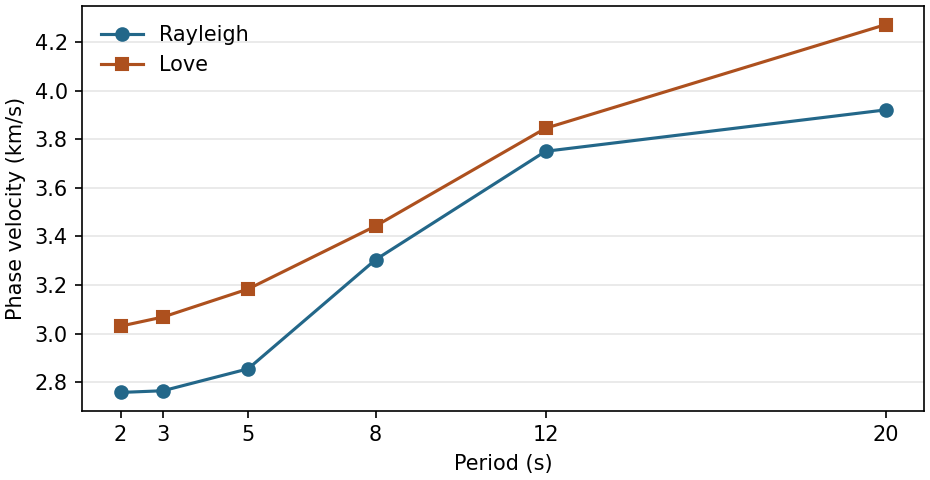
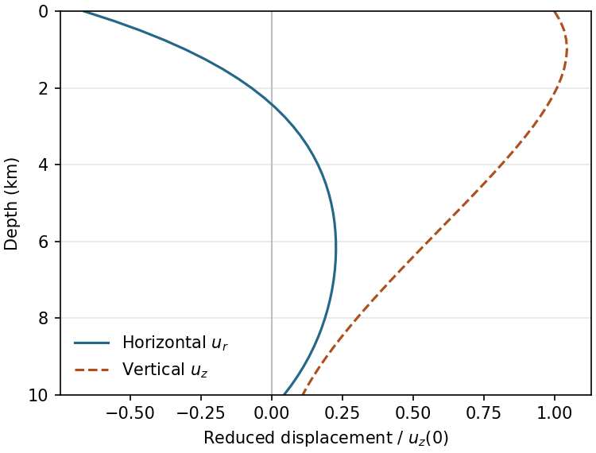

# Disper26 の練習例

[English edition](../examples/README.md)

高水準 API（`import disper26 as d26`）を使い、モデルの作成から分散曲線・固有関数・感度・Hessian の計算までを小さな例で試します。
論文で扱う手法から日常の利用に役立つものを選んだ例で、全図の再現は目的にしていません。
入力は各スクリプト内にあり、別の研究用リポジトリや論文ソースは不要です。

## 実行の準備

[インストール手順](../docs/install.md)に従い、専用のPython環境とビルドに必要なライブラリを準備します。
その環境でリポジトリのルートから次のコマンドを実行し、Disper26と練習例のテストに使うpytestなどをインストールします。

```sh
python -m pip install '.[test]'
```

開発中はソースの変更後に拡張モジュールを再ビルドします。
開発時のビルド・回帰確認手順は [READMEの検証手順](../README.md#verification) に記載しています。

## 1. モデル作成と分散曲線

```sh
python -m examples.basic_dispersion
```

[basic_dispersion.py](../examples/basic_dispersion.py) は、一つの層と半無限層からなる等方モデルで
Rayleigh波・Love波の基本モードの位相速度を計算します。
深さはkm、速度はkm/s、密度はg/cm³、周期はsです。基本モードは `mode=0` です。
最終の深度点から下が半無限層になります。

層厚やVsを変え、短周期と長周期で曲線がどう変わるかを確かめてください。



`python -m examples.tracking_options` で[追跡の例](../examples/tracking_options.py)を実行できます。
開始周期、初期速度範囲、両端でのモード番号の確認を指定し、違反時には `on_violation="fallback"` で再探索します。
既定では最長周期から計算し、入力順に結果を返します。各設定でのモード確認については [共通公開API](../docs_jp/public_api.md) を参照してください。

### 周期5秒のRayleigh波の固有関数

分散曲線上の周期5秒の点で変位が深さとともにどう変わるかを調べます。
この周期で求めた基本モードの解を `compute_eigenfunctions` に渡します。

```python
import disper26 as d26

model = d26.create_model([0., 10.], kind="layer_cake",
                         vs=[3., 4.5], vp=[5.2, 8.], rho=[2.5, 3.3])
solution = d26.compute_dispersion(model, period=5., wave="Rayleigh", mode=0)
profile = d26.compute_eigenfunctions(solution, num_sub_layers=40)
ur, uz = profile.components["ur"], profile.components["uz"]
```



地表から半無限層の上端（深さ10 km）までの間で、水平成分 `ur` は一度符号が変わり、鉛直成分 `uz` は正のままです。
振幅比を保つため、どちらも地表の鉛直成分 `uz[0]` で割って表示しています。
水平変位の位相因子 $i$ は `ur` の値には含まれません。[固有関数の符号・位相の規約](../docs/eigen_function.md)

2枚のPNGを再生成するには、練習例に使った環境にMatplotlibを追加し、リポジトリのルートから[作図スクリプト](../examples/plot_layered_model.py)を実行します。

```sh
python -m pip install matplotlib
python -m examples.plot_layered_model docs/figures/examples
```

## 2. 勾配モデルと収束診断

```sh
python -m examples.gradient_convergence
```

[gradient_convergence.py](../examples/gradient_convergence.py) は、深度ノード間で剛性を補間する
GRIDモデル（`kind="grid"`）を作り、Rombergの最大レベル `Options.max_steps` を変えた結果を表示します。
速度を補間するモデルとは異なるため、`interpolation="stiffness"` を明示しています。

位相速度に加え、採用レベル、推定相対誤差、収束状態を確認します。
小さいレベル上限での未収束は意図したものです。表に状態を表示するため、この例では
重複する `ConvergenceWarning` の表示を抑えています。
推定相対誤差は外挿した位相速度の変化から求めます。実際の誤差を測るには独立した参照解が必要です。

## 3. 感度カーネルとHessian

```sh
python -m examples.kernels_hessian
```

[kernels_hessian.py](../examples/kernels_hessian.py) は、`basis="velocity_iso"` の位相速度勾配と
Hessianを計算します。返されたパラメータ軸から上側の層のVsを選び、Vpと密度を
固定してVsだけを変えた場合の一次・二次Taylor近似を作ります。
物性を変えて順計算し直した値と比較することで、微分結果の使い方を確認できます。

二次近似が改善するのはこの例の小さな摂動で確認する性質です。大きな変更や異なる
モードへの移動まで保証するものではありません。Hessianの独立した誤差推定がない
場合は、診断を `not_evaluated` として表示します。

## 例の検証

```sh
python -m pytest -q tests/python/test_examples.py
```

同じスクリプトの計算部分を実行し、速度の範囲、指定精度での収束、二次近似の改善を
確認します。通常の `tests/python` 回帰テストにも含まれます。
過去の固定データの再集計・図の再描画は [paper/README.md](../paper/README.md) を参照してください。

<a id="advanced"></a>

## 高度な利用

出力量、微分座標、対応範囲は [共通公開API](../docs_jp/public_api.md)、計算法ごとの
直接呼び出しは [低水準API](../docs_jp/lowlevel_api.md) に記載しています。
逆解析用の `disper26_inv.ForwardEngine` は共通APIとは別の用途別入口です。
こちらはSciPyも使用するため、`python -m pip install '.[inversion]'`
で依存を用意してください。実装は [engine.py](../inversion/disper26_inv/engine.py)、
パラメータ化は [model.py](../inversion/disper26_inv/model.py) を参照できます。
