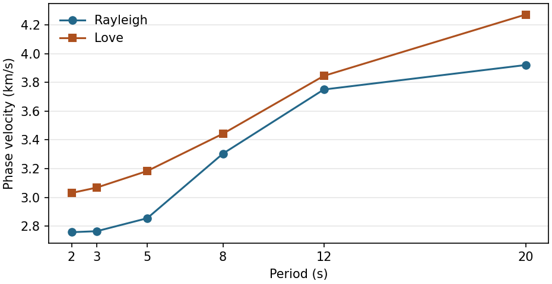
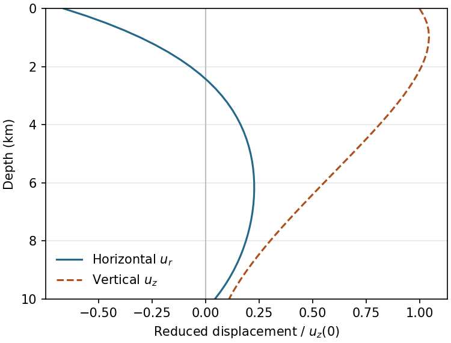

# Disper26 practice examples

These examples use the high-level Python API (`import disper26 as d26`) for
dispersion, eigenfunctions, sensitivity kernels and Hessians. All inputs are included.
A [Japanese edition](../example_jp/README.md) is available.

## Setup

Prepare a dedicated Python environment and the native dependencies as described
in the [installation guide](../docs/install.md). From the repository root,
install Disper26 and the dependencies for testing the examples, including pytest:

```sh
python -m pip install '.[test]'
```

Rebuild the extension after changing its source. See the [verification
instructions](../README.md#verification) for build and regression commands.

## 1. Model construction and dispersion curves

```sh
python -m examples.basic_dispersion
```

[basic_dispersion.py](basic_dispersion.py) computes fundamental-mode
(`mode=0`) Rayleigh and Love phase velocities for an isotropic layer over a
half-space. The last depth marks the top of the half-space. Depth is in km,
velocity in km/s, density in g/cm³ and period in s. Change the layer thickness
or Vs and compare the short- and long-period ends of each curve.



Run `python -m examples.tracking_options` for the [tracking example](tracking_options.py). It sets the starting period, initial velocity interval and endpoint checks, with `on_violation="fallback"`. The default starts at the longest
period and returns results in input order. The [shared API guide](../docs/public_api.md)
describes the checks for each setting.

### Rayleigh eigenfunctions at 5 s

To see how displacement varies with depth at the 5 s point on the Rayleigh
curve, pass the solution for that period to `compute_eigenfunctions`.

```python
import disper26 as d26

model = d26.create_model([0., 10.], kind="layer_cake",
                         vs=[3., 4.5], vp=[5.2, 8.], rho=[2.5, 3.3])
solution = d26.compute_dispersion(model, period=5., wave="Rayleigh", mode=0)
profile = d26.compute_eigenfunctions(solution, num_sub_layers=40)
ur, uz = profile.components["ur"], profile.components["uz"]
```



From the surface to the half-space boundary at 10 km, the horizontal component
changes sign once and the vertical component stays positive. Both curves show
reduced displacement divided by the surface vertical component (`uz[0]`),
preserving their relative amplitudes. The horizontal phase factor $i$ is
implicit in `ur`. See the [eigenfunction conventions](../docs/eigen_function.md).

To regenerate both PNGs, install Matplotlib in your example environment and
run the [plotting script](plot_layered_model.py) from the repository root.

```sh
python -m pip install matplotlib
python -m examples.plot_layered_model docs/figures/examples
```

## 2. Gradient model and convergence diagnostics

```sh
python -m examples.gradient_convergence
```

[gradient_convergence.py](gradient_convergence.py) uses
`kind="grid"` and `interpolation="stiffness"` to interpolate stiffness between depth nodes.
It varies `Options.max_steps`, the maximum Romberg level, and prints phase velocity, the accepted
level, estimated relative error and convergence status. The small level cap
intentionally shows an unconverged result. The table reports the status, so
the example suppresses duplicate `ConvergenceWarning` messages. The error
estimate measures the change in extrapolated phase velocity. An independent reference solution would be needed to measure the actual error.

## 3. Sensitivity kernels and the Hessian

```sh
python -m examples.kernels_hessian
```

[kernels_hessian.py](kernels_hessian.py) computes the phase-velocity gradient
and Hessian with `basis="velocity_iso"`. It selects the upper layer's Vs from the
returned parameter axis, holds Vp and density fixed, and compares first- and
second-order Taylor predictions with a fresh forward calculation. The
improvement shown here applies to small perturbations on the same mode.
The Hessian diagnostics report `not_evaluated` when the method has no
independent error estimate.

## Check the examples

```sh
python -m pytest -q tests/python/test_examples.py
```

These tests run the same calculations and check the velocity ranges, requested
convergence and improvement in the second-order prediction. They also run in
the full Python regression suite. For historical data and figure reproduction,
see the [paper guide](../paper/README.md).

<a id="advanced"></a>

## Advanced usage

The [shared API guide](../docs/public_api.md) describes outputs, derivative
coordinates and supported operations. The [low-level API guide](../docs/lowlevel_api.md)
gives direct calls for individual methods. Inversion has a separate entry
point, `disper26_inv.ForwardEngine`, which also uses SciPy. Install its
dependencies with `python -m pip install '.[inversion]'`. See
[engine.py](../inversion/disper26_inv/engine.py) for the implementation and
[model.py](../inversion/disper26_inv/model.py) for parameterization.
